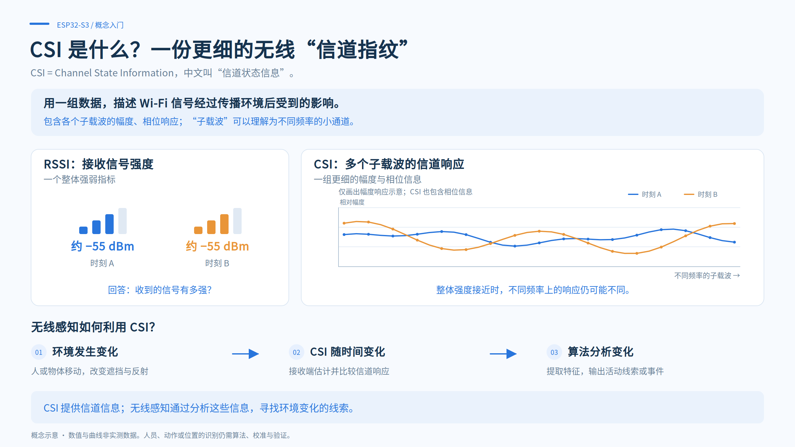
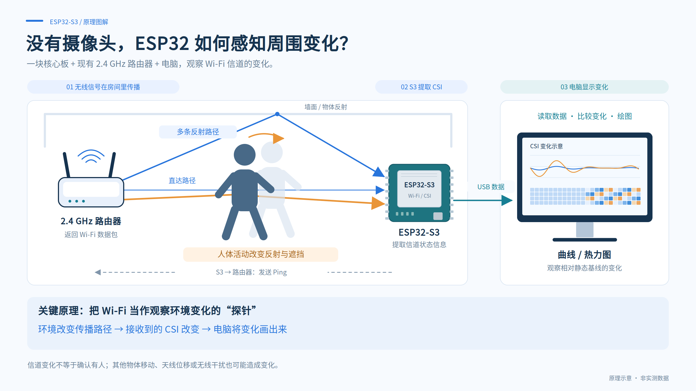
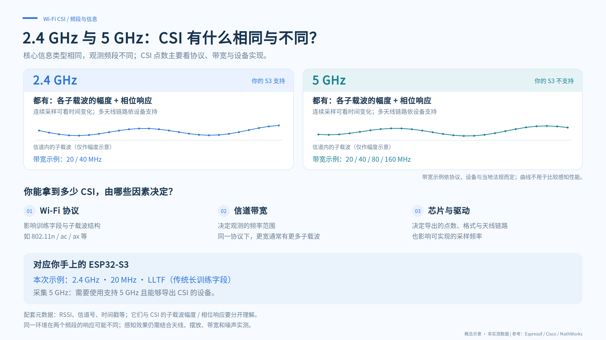
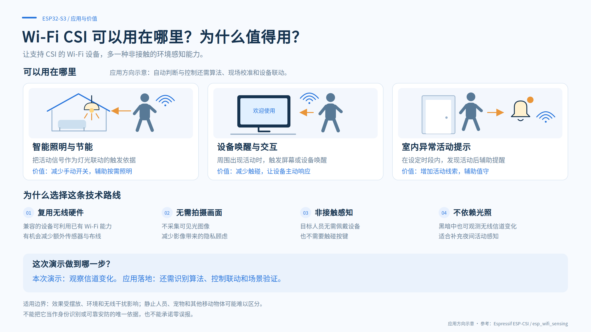

# ESP32 CSI Sense · 看见 Wi-Fi 的变化

一个用 ESP32-S3 采集 Wi-Fi CSI、在浏览器观察环境变化，并提供开发板与 Windows 电脑 Wi-Fi 链路监测的开源小实验。

## 1. 先打开上位机

### 下载与启动

1. 点击仓库右上方 **Code → Download ZIP**，或[直接下载源码 ZIP](https://github.com/bealuxDream/ESP32-CSI-Sense-toyver/archive/refs/heads/main.zip)，解压到本地。需要编译固件时，推荐使用 `D:\esp32-csi-demo` 这样的短英文路径。
2. 安装 [Python 3](https://www.python.org/downloads/windows/)（建议 3.11），安装时勾选 **Add python.exe to PATH**。已经安装 ESP-IDF 的用户也可以使用 ESP-IDF 终端中的 Python。
3. Windows 用户双击项目根目录的 **`start_viewer.cmd`**。也可以在终端进入项目目录，运行：

   ```powershell
   python viewer\serve.py
   ```

4. 保持服务窗口运行，用桌面版 **Edge / Chrome** 打开 **<http://localhost:8765>**。关闭服务用 Ctrl+C。

网页和采样服务都在本机运行，不需要云账号、npm 安装或 Python 第三方依赖。Node.js 只用于开发测试。ESP-IDF 编译工具需要另行安装。

### 三个视图，分别能看什么

| 视图 | 数据来源 | 是否需要开发板 |
| --- | --- | --- |
| **无线感知 · CSI** | ESP32-S3 的子载波数据，显示扰动曲线、频率指纹、校准与录制回放 | 实时采集需要；模拟预览不需要 |
| **开发板网络** | ESP32-S3 的 RSSI、到路由器的 Ping 延迟、超时率与掉线 / 重连统计 | 需要烧录本项目固件 |
| **电脑 Wi-Fi** | Windows 网卡的信号质量、RSSI、连接速率及到 Wi-Fi 网关的延迟、失败率和抖动 | 不需要；电脑需连接 Wi-Fi |

还没烧录时，可以先点击 **模拟预览**熟悉 CSI 界面，或打开 **电脑 Wi-Fi**查看电脑的实际链路。模拟数据会明确标注，不能当作硬件实测结果。

电脑 Wi-Fi 页约每秒采样，保留最近约 30 秒。暂停或离开此视图后停止请求，采样服务随后休眠；其他打开的监测页面仍可能保持采样。信号质量来自 Windows / 驱动，驱动支持时才显示实际 RSSI。连接速率不是下载速度；探测只覆盖电脑到路由器，不代表互联网质量。**这一页不提供电脑无线网卡的 CSI。**

## 2. 把固件烧录到 ESP32-S3

### 准备硬件和工具

- 一块 **ESP32-S3** 开发板，以及能传数据的 USB 线。本项目按 S3 配置，不直接保证兼容其他 ESP32 型号。
- 一台可连接的 **2.4 GHz Wi-Fi 路由器**，开启 DHCP，并能响应开发板发出的 Ping。实验本身不需要互联网。
- 安装 [Espressif ESP-IDF](https://docs.espressif.com/projects/esp-idf/en/v5.5.1/esp32s3/get-started/windows-setup.html)。当前 Windows 硬件验证使用 **v5.5.1**；初始工程也在 v5.4.2 编译通过，详情见 [验证记录](VALIDATION.md)。

烧录会替换板上的程序；需要保留旧程序时，请先自行备份。这个仓库不提供含 Wi-Fi 凭据的预编译固件。

### 方式 A：使用 ESP-IDF 终端

安装完成后，打开 **ESP-IDF PowerShell / CMD**。以下命令中的路径和 `COM5` 都要替换成你自己的值：

```powershell
cd D:\esp32-csi-demo\firmware
idf.py set-target esp32s3
idf.py menuconfig
```

在 **CSI Classroom Demo** 菜单中填写 **2.4 GHz Wi-Fi SSID** 和 **Wi-Fi password**，保存退出。然后执行：

```powershell
idf.py build
idf.py -p COM5 flash monitor
```

看到 `CSI ready`、持续的 `CSI,` 数据和每秒一次的 `NET,` 状态后，按 **Ctrl+]** 退出监视器，释放串口。

串口波特率是 **115200**。固件开启 UART0 主输出和 USB Serial/JTAG 次输出；根据开发板实际接线选择 USB-UART 或原生 USB 数据口。工程默认按 2 MB Flash 构建，不要求 PSRAM。

### 方式 B：使用项目的 Windows 构建脚本

如果工具链不能处理中文路径，可以使用 `build_firmware.ps1`。它把固件复制到英文临时路径编译，源码仍在项目目录。

```powershell
Copy-Item runtime.example.json runtime.local.json
Copy-Item wifi.example.json wifi.local.json
```

编辑两个新文件：

- `runtime.local.json`：填写你实际安装的 Python、ESP-IDF 和工具目录。模板中的路径只是示例。在 ESP-IDF 终端中可用 `$env:IDF_PATH`、`$env:IDF_TOOLS_PATH` 和 `python -c "import sys; print(sys.executable)"` 查询。
- `wifi.local.json`：填写自己的 2.4 GHz SSID 和密码。开放网络的密码可以是空字符串。

然后在 PowerShell 执行：

```powershell
.\build_firmware.ps1                     # 只编译
.\build_firmware.ps1 -FlashPort COM5      # 编译并烧录，替换实际串口号
```

只做编译检查时可使用 `-CompileCheck`：临时副本采用测试 SSID，不修改你的 Wi-Fi 配置，也不允许同时烧录。生成物位于 `artifacts/firmware/`。

`*.local.json`、生成的 `sdkconfig`、构建目录和固件均被 Git 忽略。**编译后的固件也可能包含 Wi-Fi 密码，请勿把自己的生成物上传或打包分享。** 普通烧录无需清理整片 Flash 或重复擦除 NVS。

### 连接上位机，做第一次实验

1. 打开上位机，点击 **连接 ESP32-S3**，选择开发板的 COM 口。退出其他串口监视器，避免占用。
2. 固定路由器、板子和 USB 线，先尝试相距约 1～3 米的摆放位置；这只是起点，不是感知距离保证。
3. 确认持续收到 CSI 后，保持环境静止，点击 **静态校准 · 8 秒**。校准至少需要 30 帧有效数据。
4. 在信号传播路径附近挥手、起身或走动，再停下来，观察曲线与热力图。不要移动板子或拉扯 USB 线。
5. 实时连接时可点击 **开始录制**，录下“静止 → 活动 → 静止”，停止后导出 JSON；之后用 **导入录制**回放。导入会先断开当前串口。

鼠标移入热力图色块，可以查看**子载波编号、帧位置与未乘显示增益的幅度偏差**。偶发的其他包格式会被过滤；确认持续切换格式、信道改变或板子计时回退时才重建分析。

### 常见问题

| 现象 | 优先检查 |
| --- | --- |
| 双击后找不到 Python | 安装 Python 并加入 PATH，或在 ESP-IDF 终端运行 `python viewer\serve.py` |
| 本地端口被占用 | 先检查已有的 <http://localhost:8765>；关闭旧服务再启动。也可运行 `python viewer\serve.py --port 8766` 并访问对应端口 |
| 编译器打不开中文路径 | 解压到短英文路径，或配置后使用方式 B |
| 一直连接不上路由器 | 检查 SSID、密码、2.4 GHz 和 DHCP；ESP32-S3 不支持 5 GHz |
| 有 `CSI ready` 但无 CSI 数据 | 检查路由器是否响应 Ping、无线链路与摆放，尝试普通家用路由器 |
| 浏览器无法打开串口 | 使用桌面 Edge / Chrome，退出 `idf.py monitor` 和其他串口程序，检查数据线与端口 |
| 校准中断或活动变化不明显 | 先确认持续采样，固定设备，调整人与传播路径的位置；调整摆放后再校准 |
| 开发板网络页没有统计 | 确认有每秒一次的 `NET,` 输出；旧录制可能只有 CSI |
| 电脑 Wi-Fi 页提示权限不足 | 检查 Windows 定位及桌面应用访问权限；无网卡、未连接或无 IPv4 网关时会显示原因 |
| 电脑 Wi-Fi 接口返回 404 | 停止旧版本的 Python 服务，再运行新版 `start_viewer.cmd` |

开发者可运行 `node tests/test_core.cjs`、`python tests/test_pc_wifi.py`。验证范围见 [VALIDATION.md](VALIDATION.md)，完整演示安排见 [讲解稿](讲解稿.md)。

## 3. 一个简短的 CSI 故事

### 什么是 CSI：比 Wi-Fi 格数更细的一份信道信息

**CSI = Channel State Information，信道状态信息。** 接收设备利用 Wi-Fi 数据包中的已知训练字段估计信道，得到不同子载波上的幅度与相位响应。

RSSI 概括“接收到的信号整体有多强”；CSI 则描述“不同频率位置上的响应是什么样”。两个时刻的 RSSI 接近，CSI 的形状仍可能不同。物体改变反射、遮挡和多条传播路径后，这份“信道指纹”也可能改变。



### ESP32 如何借助 CSI 感知变化

本项目中，ESP32-S3 连接路由器并向网关发送 Ping，路由器返回数据包。S3 从收到的数据中提取 CSI，经 USB 交给电脑分析和绘图：

**环境改变传播路径 → 接收到的 CSI 改变 → 电脑比较变化并显示。**



这里分析的是 **20 MHz LLTF 的幅度**，不做相位校准或机器学习分类。选取 51 个子载波，每帧按平均幅度归一化；扰动曲线计算相邻帧的幅度差均方根，再取最近 5 个值的平均。静态校准用 8 秒数据建立基线与实验阈值。

热力图每列是一帧，每行是一个子载波。纵轴编号表示相对信道中心的频率位置：**每增加 1，频率增加 312.5 kHz**。本项目显示 −26～−1、+2～+26，省略 DC、保护子载波及可能无效的前 4 字节。校准后，橙色表示归一化幅度高于静态基线，蓝色表示低于基线，偏差没有物理单位。

人移动后停住，扰动曲线可能回落，热力图仍保持与原基线不同的颜色：前者看“相邻时刻变了多少”，后者看“与校准时相比变成了什么样”。这些颜色不表示人体或设备占用了对应频率。

### 2.4 GHz 与 5 GHz 有什么不同

两个频段的 CSI 都可以包含子载波的幅度和相位响应。频段决定观测的频率范围；能导出多少个 CSI 点，还取决于 **Wi-Fi 协议、信道带宽、芯片与驱动实现**，不能只按 2.4 / 5 GHz 判断。

| 对比 | 2.4 GHz | 5 GHz |
| --- | --- | --- |
| 近似波长 | 约 12.5 cm | 约 6 cm |
| 常见信道带宽示例 | 20 / 40 MHz | 20 / 40 / 80 / 160 MHz，依协议、设备和法规而定 |
| 传播特点 | 相似条件下通常更利于覆盖和绕射，也可能更拥挤 | 相似条件下穿墙损耗往往更明显，可用信道和较宽带宽选择较多 |
| 本项目的 ESP32-S3 | **支持，示例固定 20 MHz** | **不支持** |



在不同频段，同一动作引起的信道响应可能不同，但“5 GHz 一定更准”或“2.4 GHz 一定更远”都需要具体条件下验证。要采集 5 GHz CSI，必须使用支持该频段且能够导出 CSI 的硬件与驱动；电脑能连上 5 GHz，并不意味着能读取 CSI。

### 为什么值得使用 CSI 技术

它让兼容的无线设备多一种**非接触、无需可见光画面**的环境观测能力。可以探索活动触发照明、设备唤醒与交互、特定时段的异常活动提示，也适合学习无线传播、信号处理和传感器融合。



这个小实验已经做到的是**观察信道变化**。从信道变化到可靠的活动识别、自动控制，还需要算法、现场校准、设备联动与受控验证。人、宠物、其他移动物体、天线位移和无线干扰都可能影响结果；本项目没有承诺人数、身份、距离或人体检测准确率。

四张配图均为原理与应用示意，图中曲线不是实测数据。官方参考见 [SOURCES.md](SOURCES.md)。项目以 [MIT License](LICENSE) 开源。
